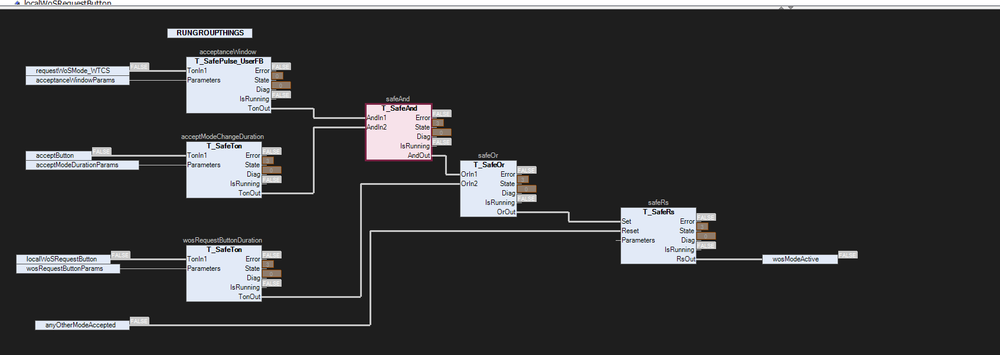
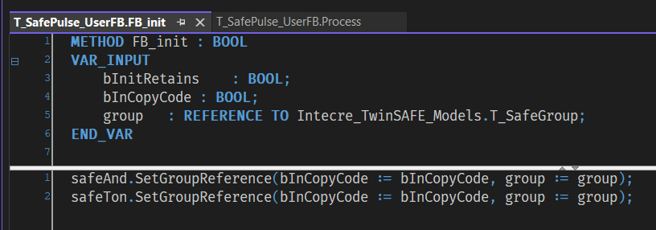
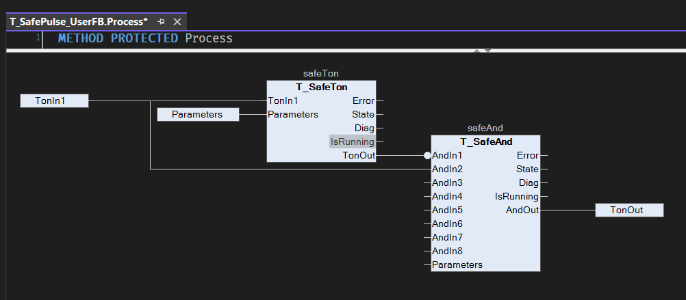

# Intecre.TwinSAFE.Models

**Functional models of the Beckhoff TwinSAFE logic function blocks and the TwinSAFE group, for a standard TwinCAT 3 PLC.**

Build and trial a safety application, and the standard-PLC code that talks to it (Run/Stop, ErrAck, Restart, EDM, state and diag info data), without any TwinSAFE hardware. Pin names, parameters, state codes and diagnostic bits follow the Beckhoff manual *TwinSAFE Logic FB* (version 4.3.0), so PLC code written against the models carries over to the real thing.

> [!WARNING]
> These are simulation models only. They are **not safety rated** and must never be used to implement a safety function.



*Mode request logic from a project using the library, drawn in CFC. A mode becomes active when a remote request pulse overlaps the accept button being held, or when the local request button is held for its duration; the latch is reset, reset dominant, when any other mode is accepted. The blocks are wired exactly as the corresponding TwinSAFE network would be, and the `State` outputs (3 = SAFE here) read as the Safety Editor's online view does. `T_SafePulse_UserFB` is a project-specific block built on `T_SafeFunctionBlockBase`, see [User function blocks](#user-function-blocks).*

## Contents

- [Getting started](#getting-started)
- [What is modelled](#what-is-modelled)
- [How the pieces fit together](#how-the-pieces-fit-together)
  - [User function blocks](#user-function-blocks)
- [Standard PLC interface](#standard-plc-interface)
- [Input configuration](#input-configuration)
- [What the Safety Editor refuses](#what-the-safety-editor-refuses)
- [Test hooks](#test-hooks)
- [Behaviour notes and assumptions](#behaviour-notes-and-assumptions)
- [Tests](#tests)
- [Conventions](#conventions)
- [Version history](#version-history)

## Getting started

### Requirements

| | |
|---|---|
| TwinCAT | 3.1 build 4026 |
| Library version | 0.4.4.0 |
| Libraries | `TcUnit, * (www.tcunit.org)`, `Intecre.Utilities, * (Intecre Ltd)` (4.1.0.0 or later, for the logger and `T_NamedBase`; no TcPkg package carries it yet, so the `Intecre.TwinSAFE.Models` package does not pull it in: install it by hand), `Tc2_Standard`, `Tc2_System`, `Tc3_Module` |

### Use it

Either open the solution and work in it directly, or install the library and reference `Intecre.TwinSAFE.Models` from your own project. Releases are published to `bin/` in two forms:

- **`bin/Intecre_TwinSafeModels.library`**: install it through the TwinCAT *Library Repository* dialog.
- **`bin/Intecre.TwinSAFE.Models.<version>.nupkg`**: a TcPkg package that installs the library for you. Several versions can be installed side by side.

To install the package, add `bin/` as a local feed and install from it:

```powershell
tcpkg source add -n "Intecre local" -s "<repository>\bin"
tcpkg install Intecre.TwinSAFE.Models
```

The package is not signed. TcPkg refuses unsigned packages until signature checking is switched off with `tcpkg config unset -n VerifySignatures`, which applies to every feed, so switch it back on afterwards if you rely on it.

The PLC project is set up as a library (title `Intecre.TwinSAFE.Models`, company Intecre Ltd, version in the project properties, generated into `Version/Global_Version.TcGVL` and `F_GetVersion`).

> [!NOTE]
> Up to 0.4.0.0 the library was kept in the repository root, and the 0.2.0.0 build was shipped as `TwinSafeModels.library`. All builds install as `Intecre.TwinSAFE.Models` in the library repository, so check the version rather than the file name.

The project compiles cleanly in TwinCAT 3.1 4026 (verified with *Check all objects*). See [Tests](#tests) for running the TcUnit suites.

### Solution layout

```text
Intecre.TwinSAFE.Models.sln
bin/                                     published releases
  Intecre_TwinSafeModels.library         installable library build of the PLC project (0.4.4.0)
  Intecre.TwinSAFE.Models.*.nupkg        TcPkg packages of each release
Intecre.TwinSAFE.Models/                 TwinCAT solution project (tsproj)
  _Config/PLC/                           PLC instance configuration
  Intecre_TwinSafeModels/                PLC project (library Intecre.TwinSAFE.Models)
    Core/                                group, connection, terminal models, FB base class, helpers
    DUTs/                                state / diag enums and parameter structs
    FunctionBlocks/                      one T_Safe* FB per TwinSAFE FB
    Params/                              SafeModelParams, the library parameter list (RAISE_ON_REFUSED_CONFIGURATION)
    Tests/                               TcUnit suites in ST (T_*_Tests) and CFC (T_*_Tests_CFC), T_SafeCfcTestSuite, PRG_TestRunner
      User_FB_Tests/                     suites for the example user FBs (T_*_UserFB_Tests and their CFC twins)
    Examples/                            PRG_EStopExample (ST) and PRG_EStopExample_CFC (same wiring in CFC)
      Example_UserFbs/                   T_SafePulse_UserFB and T_SafeRTrig_UserFB, example user FBs with Process drawn in CFC
    Project Information/, Version/       generated from the project properties (title, company, version)
    PlcTask.TcTTO                        10 ms task, runs PRG_TestRunner and both examples
docs/images/                             screenshots used in this README
```

## What is modelled

| TwinSAFE FB | Model | Parameters | Notes |
|---|---|---|---|
| AND | `T_SafeAnd` | `ST_SafeLogicParameters` | AndIn1 may be a standard signal |
| OR | `T_SafeOr` | `ST_SafeLogicParameters` | |
| XOR | `T_SafeXor` | none | EL6910 |
| DECOUPLE | `T_SafeDecouple` | none | |
| OPMODE | `T_SafeOpMode` | `ST_SafeOpModeParameters` | manual restart when Restart is wired, discrepancy time |
| ESTOP | `T_SafeEStop` | `ST_SafeEStopParameters` | 4 input pairs, EDM1/2, delayed output, EDM reset time |
| MON | `T_SafeMon` | `ST_SafeMonParameters` | Secure pair, manual restart, function test, ERRORDELAY |
| TWOHAND | `T_SafeTwoHand` | `ST_SafeTwoHandParameters` | 1BUTTON / 2BUTTON / RELEASE states |
| MUTING | `T_SafeMuting` | `ST_SafeMutingParameters` | sequential and parallel sensors, filter, max time, backwards, OSSD optional |
| EDM | `T_SafeEdm` | `ST_SafeEdmParameters` | switch-on / switch-off monitoring |
| RS | `T_SafeRs` | `ST_SafeLatchParameters` | reset dominant |
| SR | `T_SafeSr` | `ST_SafeLatchParameters` | set dominant |
| TON | `T_SafeTon` | `ST_SafeTimerParameters` | |
| TOF | `T_SafeTof` | `ST_SafeTimerParameters` | |
| CONNECTION SHUTDOWN | `T_SafeConnShutdown` | `ST_SafeConnShutdownParameters` | takes the `T_SafeConnection` it shuts down at initialisation |
| TwinSAFE group | `T_SafeGroup` | none | EL/EJ6910 inputs and outputs; FBs and connections register with it at initialisation |
| TwinSAFE connection | `T_SafeConnection` | inputs | FSoE state codes 100..106 |
| EL1904 | `T_SafeInputTerminal` | inputs | four channels, fail-safe inputs unless in Data |
| EL1918 | `T_SafeInputTerminal8` | inputs | eight channels, as EL1904 |
| EL2904 | `T_SafeOutputTerminal` | inputs | four channels, fail-safe outputs unless in Data with the group in RUN (`OutputsEnabled`) |
| EL2912 | `T_SafeOutputTerminal2` | inputs | two channels, as EL2904 |

> [!NOTE]
> Not modelled: TON2 (remaining-time persistence), the analogue and drive blocks (ADD, SUB, MUL, DIV, COMPARE, LIMIT, COUNTER, SCALE, SPEED, LOADSENSING, CAMMONITOR, SLI, SLP, SBT, ADVPOSMON, Envelope, ViolationCounter, safeCAM, safeLookUpTable, safeSequence), group customising (Deactivate / Passivate), and terminal module errors (*Module error is ComError*).

## How the pieces fit together

Every block is a plain function block with `VAR_INPUT` / `VAR_OUTPUT` pins named as in the manual and called like any TwinCAT FB, so it can be placed and wired in FBD or CFC exactly as in the Safety Editor. The only public method is `SetGroupReference`, used when composing [user function blocks](#user-function-blocks).

- **Ports are active when connected.** Each signal input carries an `{attribute 'is_connected'}` flag, so a pair is two channel when both pins are wired, `Restart` connected means manual restart, `EDMx` connected activates the feedback loop, and so on. Unwired pins are ignored, as inactive ports are in TwinSAFE.
- **Parameters** that live in the Safety Editor property grid (contact type, discrepancy and delay times, options) are one `Parameters` struct input with defaults, normally set in the declaration:
  `eStop : T_SafeEStop := (Parameters := (DiscrepancyTime1 := T#500MS, DelayTime := T#1S));`
- **Group membership.** Every FB and connection takes its group by reference at initialisation (`eStop : T_SafeEStop(group := group);`) and registers itself, as a block placed in a TwinSAFE group belongs to it. Members read the group's `InRun` and `ErrAck` themselves, and the group scans its members' `Error`, `IsRunning`, `ComError` and `InStartup` outputs each cycle, so there is no group wiring to draw. Call the group before its members; declare it before them (the group is passed by reference, so it must exist when the members initialise). `T_SafeConnShutdown` takes the connection it shuts down the same way: `(group := group, connection := outputTerminal)`. A group holds up to 256 function blocks and 64 connections (`MAX_FUNCTION_BLOCKS`, `MAX_CONNECTIONS` in `T_SafeGroup`; 64 and 32 before 0.4.3.0); its read-only properties `FunctionBlockCount`, `ConnectionCount` and `GroupState` show what has registered. A member that cannot join because the group is full is dropped silently by the registration, except that the group's `RegistrationRefused` output goes TRUE and stays TRUE: an unregistered block still runs (it reads `InRun` through its reference) but its `Error` never reaches the group, so a model with `RegistrationRefused` set is incomplete. Assert it FALSE in a test of any large group.

```iecst
VAR
    group          : T_SafeGroup;
    inputTerminal  : T_SafeInputTerminal(group := group);
    outputTerminal : T_SafeOutputTerminal(group := group);
    eStop          : T_SafeEStop(group := group) := (Parameters := (DiscrepancyTime1 := T#500MS, DelayTime := T#1S));
END_VAR

group(Run := plcSafetyRun, ErrAck := plcSafetyErrAck);
inputTerminal(Channel1 := fieldEStopNc1, Channel2 := fieldEStopNc2);
eStop(Restart := hmiRestart, EDM1 := contactorFeedback,          // standard PLC signals
      EStopIn1 := inputTerminal.SafeIn1, EStopIn2 := inputTerminal.SafeIn2);
outputTerminal(SafeOut1 := eStop.EStopOut);
```

`PRG_EStopExample` is a runnable version of this with a simulated contactor feedback loop, and `PRG_EStopExample_CFC` is the same program drawn in CFC, the closest standard-PLC equivalent of the Safety Editor: one box per block, wired pin to pin, with the group standing alone because membership is fixed at declaration. The screenshot at the top of this page shows a larger application drawn the same way.

### User function blocks

A TwinSAFE *user FB* (a reusable block made of standard blocks) is modelled by extending `T_SafeFunctionBlockBase` in the consuming application. Three parts make a composite block; `T_SafePulse_UserFB` from `Examples/Example_UserFbs` is used as the example throughout.

**1. Declaration.** Declare the pins as `VAR_INPUT` / `VAR_OUTPUT` with their TwinSAFE names and hold the inner library blocks as members. The members are constructed with the composite's own `_group` reference, inherited from the base class. Members initialise before the block that contains them, so `_group` is still empty at that moment; that is expected, and a block without a valid group simply behaves as a stopped block until it is given one.

```iecst
FUNCTION_BLOCK T_SafePulse_UserFB EXTENDS T_SafeFunctionBlockBase
VAR_INPUT
    TonIn1     : BOOL;
    Parameters : ST_SafeTimerParameters;
END_VAR
VAR_OUTPUT
    TonOut : BOOL;
END_VAR
VAR
    safeTon : T_SafeTon(_group);
    safeAnd : T_SafeAnd(_group);
END_VAR
```

**2. FB_init.** Declare `FB_init` with the same three parameters as the base class. TwinCAT calls the base `FB_init` implicitly with them, which registers the composite itself with the group (do not call `SUPER^.FB_init` yourself; the compiler rejects it as already called). The body then hands the real group on to each inner block with `SetGroupReference`, so the inner blocks register as well and take `FbRun` and `ErrAck` from the group like any other member. Forward `bInCopyCode` as shown: an online-change copy must not register a second time. Registering twice with the same group is harmless and registration with an invalid reference is ignored, so the order of initialisation never matters.

```iecst
METHOD FB_init : BOOL
VAR_INPUT
    bInitRetains : BOOL;
    bInCopyCode  : BOOL;
    group        : REFERENCE TO T_SafeGroup;   // forwarded to the base FB_init implicitly
END_VAR

safeTon.SetGroupReference(bInCopyCode := bInCopyCode, group := group);
safeAnd.SetGroupReference(bInCopyCode := bInCopyCode, group := group);
```



*The same `FB_init` in a project that uses the library, where the group type carries the library namespace.*

**3. Process and the body.** Implement the protected `Process` method, in ST or as a CFC diagram, calling the inner blocks and wiring the composite's pins to theirs. The composite's own body must call the base body, `SUPER^();` in ST or a `SUPER^` box in CFC, and nothing else. Do not call `Process` from the body directly: that skips the base body, so the composite never reads the group and `IsRunning` is never derived. The examples did this up to 0.4.0.0. The base body runs every cycle: it reads `InRun` and `ErrAck` from the group, sets `State` to `Run` while the group runs and to `Stop` otherwise, calls `Process`, then derives `IsRunning` from `State`. A composite built only from logic blocks therefore needs no `State`, `Error` or `Diag` logic of its own (since 0.4.2.0; before that `State` stayed at its default and the composite never reported Run, so the group's `FbRun` output stayed FALSE). A composite with states of its own overwrites `State` in `Process` and writes `Error` and `Diag` when it has them; the base never resets those two, because they latch until the group's `ErrAck` in TwinSAFE. Writing `IsRunning` inside `Process` has no effect.

The application then declares the block beside the standard ones: `acceptanceWindow : T_SafePulse_UserFB(group := safeGroup);`. `T_SafeConnection` and the terminals have the same `SetGroupReference` method, so a composite can contain a connection too; a connection without a valid group stays in its initial fail-safe state.

#### The two examples

`T_SafePulse_UserFB` makes a pulse: `TonIn1` feeds a TON and one AND input, and the TON output is negated into the other AND input, so `TonOut` is on from the rising edge of `TonIn1` until `DelayTime` has elapsed or the input drops. It is the acceptance window in the screenshot at the top of this page.



*`Process` of `T_SafePulse_UserFB`: the composite's pins on the left and right, the two inner blocks in between, wired as the TwinSAFE user FB would be.*

`T_SafeRTrig_UserFB` detects a rising edge: `Signal` sets an RS latch and, negated, resets it; an AND combines `Signal` with the negated latch output, so `Trigger` is on for the one cycle in which `Signal` is on and the latch has not yet caught up. That only works if the AND executes before the RS, so the diagram uses explicit execution order (right-click the CFC editor, *Execution Order*) with the AND first, as a Safety Editor network numbered AND = 1, RS = 2 would read the latch's previous value. In auto data flow mode the editor runs the RS first and the trigger never fires.

Both blocks have test suites under `Tests/User_FB_Tests`, `T_SafePulse_UserFB_Tests` and `T_SafeRTrig_UserFB_Tests` with CFC twins, covering the pulse timing, the one-cycle trigger, the stopped group and the registration of the composite and its inner blocks (`FunctionBlockCount` = 3).

## Standard PLC interface

What the standard PLC normally links to, and where it is on the models:

| TwinSAFE | Model |
|---|---|
| Group Run/Stop, ErrAck, ModuleFault | `T_SafeGroup.Run` (defaults to TRUE), `.ErrAck`, `.ModuleFault` |
| Group ComErr, FbErr, OutErr, OtherErr, ComStartup, FbDeactive, FbRun, InRun | outputs of the same name |
| Group Map State / Map Diag | `T_SafeGroup.State`, `.Diag` (`E_SafeGroupState`, `E_SafeGroupDiag`) |
| FB Standard-In ports (Restart, EDMx, AndIn1, MutingEnable, Mon1/2) | the FB `VAR_INPUT` of that name |
| FB Standard-Out ports (Error, xxxOut) | the FB `VAR_OUTPUT` of that name |
| FB Map State / Map Diag | `State : BYTE`, `Diag : WORD` on every FB |
| Connection Map State / Map Diag, ComErrAck | `State`, `Diag`, `ComErrAck` on `T_SafeConnection` and the terminals; set `ComErrAckActive` to require `ComErrAck` as well as the group ErrAck |

## Input configuration

A port's *Active* setting is its wiring (`is_connected`). *Contact type* is the `<Port>MakeContact` field of the `Parameters` struct (FALSE = break contact, logic 0 requests the safe state; TRUE = make contact, the signal is negated). A pair is two channel when both ports are wired; a `DiscrepancyTime` of `T#0S` means two channel without discrepancy monitoring.

`T_SafeInputPair` implements the discrepancy monitoring and the *Safe Inputs after Disc Error* rule (both channels must have been in the safe state together before the error can be acknowledged; diag bit 8+ is set while that is outstanding).

## What the Safety Editor refuses

The Safety Editor's project-level verify rejects some wirings and parameter values that a plain function block would happily run with, and it only checks the blocks inside a user FB once an instance of that user FB sits in a group, so the mistake surfaces late. The models apply the same rules, so a chart the editor will reject fails in simulation first.

| Blocks | Rule | Editor message |
|---|---|---|
| `T_SafeAnd`, `T_SafeOr` | at least two inputs connected | `<block> does not have at least 2 input ports active and connected` |
| `T_SafeOpMode` | at least two `OpIn` connected | `<block> does not have at least 2 input ports connected` |
| `T_SafeMon` | at least one of `MonIn1..4` connected | `<block> does not have at least 1 MonIn(x) port active and connected` |
| `T_SafeSr`, `T_SafeRs`, `T_SafeTon`, `T_SafeTof`, `T_SafeEdm` | every input connected | `Inport Set of <block> must be connected` |
| `T_SafeMon`, `T_SafeEStop`, `T_SafeMuting` | `Edm1ResetTime`, `Edm2ResetTime` are 0 ms or a multiple of 10 ms, at most 60000 ms | `'Reset Time' parameter ... has to be 0 ms or a multiple of 10 ms and maximal 60000 ms` |

A one-input AND used as an inverter is the common case: the editor refuses it, so the model does too.

A block that breaks a rule runs as a stopped block (outputs at their safe value), reports `Error` with `State` = 4 (ERROR) and **diagnostic bit 15** (`Diag` = `16#8000`, a bit no TwinSAFE FB uses), and its group goes to ERROR like for any FB error. `ErrAck` does not clear it: a configuration error cannot be acknowledged away, only rewired. The fault is logged once per instance through the `Intecre.Utilities` logger (`F_LogError`) as `<program.suite.instance>: <block type>: <editor's rule> (the TwinSAFE Safety Editor refuses this configuration)`, for example `PRG_TestRunner.safeAndTests.fb_5: T_SafeAnd: AND does not have at least 2 input ports active and connected (the TwinSAFE Safety Editor refuses this configuration)` as the TwinCAT log of the test run shows it, so it shows in the TwinCAT log of a simulation run once the project has switched the logger on: `Intecre.Utilities` logs nothing by default (`LogConfig.LogLevel` starts at `None`), so set `LogConfig.LogLevel := E_LogSeverity.Error` (or a lower level) in the project, as `PRG_TestRunner` does. The instance path comes from a private `T_NamedBase` member of the base class (its own `._log` segment trimmed off), so the blocks keep their pins-only public surface.

The check is `T_SafeFunctionBlockBase.ConfigurationOk`, called before `Process` every cycle; a block with a rule overrides it. A [user function block](#user-function-blocks) can override it as well to add rules of its own.

**Stopping hard.** With `T_SafeGroup.RaiseOnRefusedConfiguration` TRUE, a member of that group that breaks a rule also raises `RTSEXCPT_IO_CONFIG_ERROR` with `F_RaiseException` (Tc2_System) after it has reported the error, so a simulation stops on the first cycle with the fault in the event log. The property starts at the library parameter `SafeModelParams.RAISE_ON_REFUSED_CONFIGURATION` (default FALSE), which a project sets for all its groups in the Library Manager's parameter view without rebuilding the library; project code or a test sets the property per group (`safeGroup.RaiseOnRefusedConfiguration := TRUE;`). A parameter list has to be constant, so the per-group property is what a test switches for one call. A block that has no group yet follows the library parameter. A test can assert the refusal by making the call inside `__TRY` and checking in `__CATCH` that an exception arrived (TwinCAT 3.1 4024 on 32-bit, 4026 on 64-bit runtimes); `T_SafeAnd_Tests.Test_RaiseOnRefusedConfigurationStopsHard` does exactly that. The code does not survive the trip: on the 4026 x64 usermode runtime `__CATCH` received `16#E8940001`, a TwinCAT value the documentation does not list, instead of `RTSEXCPT_IO_CONFIG_ERROR`, so match on the block's `Error` and `Diag` rather than on the caught code. Beckhoff warns that on x86 (32-bit) targets an intercepted exception caused by a floating-point operation can leave the system in an unrecoverable state; the models raise no floating-point exception, but keep floating-point code out of your own `__TRY` blocks on x86.

Not covered: the editor's rule for XOR is unknown (the manual gives none), so `T_SafeXor` accepts any wiring, and the manual does not require an `EStopIn` on ESTOP, so `T_SafeEStop` is checked for its reset times only. The CFC twins carry no copies of the configuration tests.

## Test hooks

- `InjectComError` (rising edge) on `T_SafeConnection` and the terminals simulates an FSoE error with `InjectErrorCode` (default watchdog).
- `PartnerShutdown` on `T_SafeConnection` simulates a shutdown command from the FSoE partner.
- `StartupTime` sets how long a connection takes to reach the Data state (default 300 ms).

## Behaviour notes and assumptions

Where the manual is explicit the models follow it. Where it is silent the following choices were made. Each is a candidate to revisit once compared against real hardware.

<details>
<summary><strong>Group</strong></summary>

- FB errors are sticky: an FB in ERROR stays in ERROR when the group stops (group shows STOPERROR) and only leaves via ErrAck. The manual's FB tables say STOP for `FbRun = FALSE` without exception, but STOPERROR would not exist otherwise.
- The manual says an EL6910 group is in STOPERROR after initialisation when connections are assigned. The model starts in STOP and goes to START while connections come up, without needing an ErrAck.
- The group scans its members' outputs when it is called, so it sees FB and connection states from the previous cycle when the group is called first, as recommended.
- Connections start up once the group `Run` input is TRUE and do not restart when it goes FALSE.
- SAFE (3), DEACTIVE (16) and WAITCOMERROR (17) group states exist in the enum but are never entered.

</details>

<details>
<summary><strong>ESTOP / MON</strong></summary>

- While Restart is TRUE in SAFE the EDM inputs are checked immediately (restart behaviour sample 3), so a held restart during an e-stop event produces an EDM error before the contactors drop out.
- An EDM error is cleared by ErrAck alone. Discrepancy errors additionally need the *safe inputs* rule.
- MON without manual restart never raises an EDM error; it stays in SAFE while EDM is FALSE (as documented).
- MON manual function test is required once after STOP → running, not again after an ErrAck.
- The DELAYOUT delay runs to completion even if the inputs return to normal during the delay.

</details>

<details>
<summary><strong>OPMODE</strong></summary>

- The discrepancy timer only runs after a mode had been selected at least once since the FB started, so a selector left between positions at power-up does not raise an error.

</details>

<details>
<summary><strong>TWOHAND</strong></summary>

- From SAFE, both hands actuated in the same cycle go via 1BUTTON and reach RUN a cycle later.
- Diag bit 2 (discrepancy between the hands) waits for both hands released before acknowledgement when *Safe Inputs after Disc Error* is set (bit 10).

</details>

<details>
<summary><strong>MUTING</strong></summary>

- Sensor order (from the state table): four sequential sensors `M1↑ M2↑ OSSD↓ M3↑ M1↓ M4↑ M2↓ OSSD↑ M3↓ M4↓`; two sensors (parallel mode, or sequential with MutingIn3/4 unwired) `S1↑ S2↑ OSSD↓ S1↓ OSSD↑ S2↓`. The two-sensor order is an assumption.
- Any sensor or OSSD change that is not the next expected event violates the sequence (diag bit 6).
- A sensor actuated out of order while `MutingEnable` is TRUE and no sequence is running is a violation.
- OSSD interrupted with no sequence running gives SAFE (automatic restart when clear), never an error.
- Withdrawing `MutingEnable` mid-sequence abandons the sequence; the OSSD then decides RUN / SAFE.
- EDM inputs gate the SAFE → RUN transition without raising an error (there is no Restart input); the EL6910 *Reset Time* option does raise diag bits 4/5.

</details>

<details>
<summary><strong>Timers</strong></summary>

- TON / TOF use the PLC task time. TwinSAFE timebase quantisation (1 / 10 / 100 ms) is not modelled.

</details>

## Tests

`PRG_TestRunner` runs 42 TcUnit suites: one ST suite (`T_*_Tests`) and one CFC twin (`T_*_Tests_CFC`) for each of the 16 function blocks, `T_SafeGroup`, `T_SafeConnection`, `T_SafeInputPair` and the two example user FBs (70 tests on the ST side, 55 on the CFC side, 125 in total), plus ST suites for the EL1918 and EL2912 terminal models (9 tests). The 13 extra ST tests check the configurations the Safety Editor refuses (see [What the Safety Editor refuses](#what-the-safety-editor-refuses)); they have no CFC twins. The terminal models are plain connections with a channel copy, so they have no CFC twins; the EL1904 model is exercised by the group suites. The CFC suites exercise the blocks the way a TwinSAFE project is authored: each test method is a diagram with the calls down the middle in execution order and, beside each call, the asserts that check it, their `Actual` pins wired straight from the block's output pins as a TwinSAFE network would be wired. The methods use explicit execution order (the sequence the boxes were placed in), so a timed test that calls the same block several times in one diagram runs its calls and asserts in the order written; in auto data flow mode the editor reorders wired boxes and those tests assert at the wrong moment. Timed tests use chained `TON` timers and `R_TRIG` one-shots on the `EN` of the assert boxes instead of the ST `CASE` state machines, so the two versions of a timed test are equivalent rather than identical.

The CFC suites extend `T_SafeCfcTestSuite` rather than `TcUnit.FB_TestSuite` directly. TcUnit's `TEST` and `TEST_FINISHED_NAMED` are functions without a return type, and a CFC box for a function must carry a return pin, so that small base class wraps them as the methods `StartTest` and `FinishTest` that the diagrams call.

Activate the configuration, log in, and read the results in the TwinCAT error list or through the TcUnit xUnit output. `PlcTask` (10 ms) runs `PRG_TestRunner` alongside the two examples. Timed tests use waits of 10 to 400 ms, so a full run takes a few seconds.

The ST suites rely on the `is_connected` semantics: a pin passed in the call `fb(Pin := x)` reads as connected, an omitted pin as unconnected.

## Conventions

Blocks use the `T_` prefix, private members `_camelCase`, and state machines use `CASE` with a `StateChanged()` entry pattern. Deliberately unlike the house class style, the blocks expose only `VAR_INPUT` / `VAR_OUTPUT` pins and no public methods other than `SetGroupReference`, so they behave like their TwinSAFE equivalents and wire up in FBD and CFC.

## Version history

| Version | Date | Changes |
|---|---|---|
| 0.5.0.0 | 2026-11-10 | The models refuse the configurations the Safety Editor refuses (see [What the Safety Editor refuses](#what-the-safety-editor-refuses)): `T_SafeFunctionBlockBase.ConfigurationOk`, diagnostic bit 15, a log line through the `Intecre.Utilities` logger (new reference) with the instance path from a private `T_NamedBase` member and the opt-in hard stop (`T_SafeGroup.RaiseOnRefusedConfiguration`, default from the library parameter `SafeModelParams.RAISE_ON_REFUSED_CONFIGURATION`). 13 ST tests; the one-input ANDs in the AND and group suites now have two inputs. `SafeInputsAfterDiscError` now defaults to FALSE in every parameter struct, like the Safety Editor's checkbox for a new block; ESTOP ignores it and always applies the function, as the EL6910 does (before, every struct defaulted to TRUE). New reference `Intecre.Utilities`. All 134 TcUnit tests pass on the TwinCAT 3.1 4026 x64 usermode runtime (2026-11-10). |
| 0.4.4.0 | 2026-10-29 | A safe output terminal passes its `SafeOut` values only while its connection is in Data and its group is in RUN (`T_SafeConnection.OutputsEnabled`): a group in STOP or ERROR switches every output of the group off, as the EL6910 does, even for a value wired straight from an input to an output. Before, that reaction existed only through the blocks stopping, so a direct wire kept its output on. One terminal test. |
| 0.4.3.0 | 2026-10-29 | `T_SafeGroup` holds 256 function blocks and 64 connections (was 64 and 32: a simulated group of door functions had passed the cap and most of its blocks could not put the group in error), and its new `RegistrationRefused` output shows a member that could not join. Two group tests. |
| 0.4.2.0 | 2026-10-22 | `T_SafeFunctionBlockBase` sets `State` to Run or Stop from the group before `Process`, so a composite without states of its own reports Run to its group without any `State` logic in its chart. The example user FBs drop the `IsRunning` AND that the base body overwrote; their suites assert `IsRunning`. |
| 0.4.1.1 | 2026-10-21 | The example user FBs call `SUPER^` from their body instead of `Process`, so the base body runs. Releases are published to `bin/` as a `.library` and a TcPkg package; the copy in the repository root is removed. |
| 0.4.0.0 | 2026-10-19 | `T_SafeInputTerminal8` (EL1918, eight channels) and `T_SafeOutputTerminal2` (EL2912, two channels) in `Core`, with ST test suites. Built and installed with `tclib publish`. |
| 0.3.0.0 | 2026-10-16 | Example user FBs `T_SafePulse_UserFB` and `T_SafeRTrig_UserFB` under `Examples/Example_UserFbs`, showing how a composite block is declared and how its `FB_init` passes the group on, with TcUnit suites (ST and CFC twins) under `Tests/User_FB_Tests`. Library file is `Intecre_TwinSafeModels.library` again. |
| 0.2.0.0 | 2026-09-22 | Group membership by reference (`FB_init(group := ...)`, `SetGroupReference` for composite blocks) with guards for a missing group; FBD test suites and example replaced by CFC twins on `T_SafeCfcTestSuite`. Shipped as `TwinSafeModels.library`. |
| 0.1.1.0 | 2026-09-14 | First release: the 16 logic FBs, the group, connection and terminal models, with ST and FBD TcUnit suites. |
