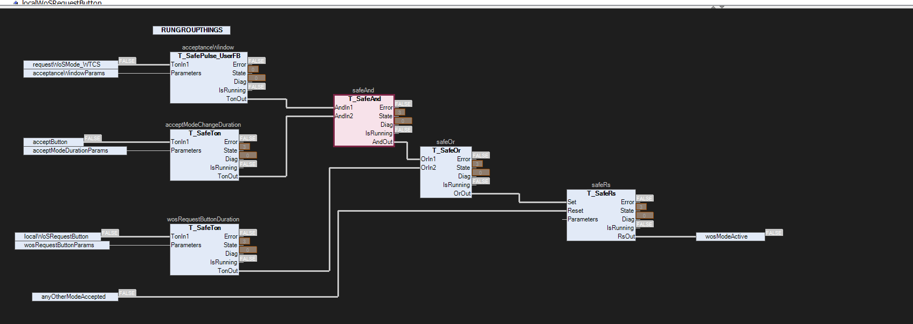

# Intecre.TwinSAFE.Models

**Functional models of the Beckhoff TwinSAFE logic function blocks and the TwinSAFE group, for a standard TwinCAT 3 PLC.**

Build and trial a safety application, and the standard-PLC code that talks to it (Run/Stop, ErrAck, Restart, EDM, state and diag info data), without any TwinSAFE hardware. Pin names, parameters, state codes and diagnostic bits follow the Beckhoff manual *TwinSAFE Logic FB* (version 4.3.0), so PLC code written against the models carries over to the real thing.

> [!WARNING]
> These are simulation models only. They are **not safety rated** and must never be used to implement a safety function.



*Mode request logic from a project using the library, drawn in CFC. A mode becomes active when a remote request pulse overlaps the accept button being held, or when the local request button is held for its duration; the latch is reset, reset dominant, when any other mode is accepted. The blocks are wired exactly as the corresponding TwinSAFE network would be, and the `State` outputs (3 = SAFE here) read as the Safety Editor's online view does. `T_SafePulse_UserFB` is a project-specific block built on `T_SafeFunctionBlockBase`, see [User function blocks](#user-function-blocks).*

## Contents

- [Getting started](#getting-started)
- [What is modelled](#what-is-modelled)
- [How the pieces fit together](#how-the-pieces-fit-together)
  - [User function blocks](#user-function-blocks)
- [Standard PLC interface](#standard-plc-interface)
- [Input configuration](#input-configuration)
- [Test hooks](#test-hooks)
- [Behaviour notes and assumptions](#behaviour-notes-and-assumptions)
- [Tests](#tests)
- [Conventions](#conventions)

## Getting started

### Requirements

| | |
|---|---|
| TwinCAT | 3.1 build 4026 |
| Library version | 0.2.0.0 |
| Libraries | `TcUnit, * (www.tcunit.org)`, `Tc2_Standard`, `Tc2_System`, `Tc3_Module` |

### Use it

Either open the solution and work in it directly, or install `TwinSafeModels.library` (version 0.2.0.0) from the repository root into the TwinCAT library repository and reference `Intecre.TwinSAFE.Models` from your own project. The PLC project is set up as a library (title `Intecre.TwinSAFE.Models`, company Intecre Ltd, version in the project properties, generated into `Version/Global_Version.TcGVL` and `F_GetVersion`).

> [!NOTE]
> `Intecre_TwinSafeModels.library` in the repository root is the earlier 0.1.1.0 build. Install `TwinSafeModels.library` instead.

The project compiles cleanly in TwinCAT 3.1 4026 (verified with *Check all objects*). See [Tests](#tests) for running the TcUnit suites.

### Solution layout

```text
Intecre.TwinSAFE.Models.sln
TwinSafeModels.library                   installable library build of the PLC project (0.2.0.0)
Intecre_TwinSafeModels.library           earlier library build (0.1.1.0)
Intecre.TwinSAFE.Models/                 TwinCAT solution project (tsproj)
  _Config/PLC/                           PLC instance configuration
  Intecre_TwinSafeModels/                PLC project (library Intecre.TwinSAFE.Models)
    Core/                                group, connection, terminal models, FB base class, helpers
    DUTs/                                state / diag enums and parameter structs
    FunctionBlocks/                      one T_Safe* FB per TwinSAFE FB
    Tests/                               TcUnit suites in ST (T_*_Tests) and CFC (T_*_Tests_CFC), T_SafeCfcTestSuite, PRG_TestRunner
    Examples/                            PRG_EStopExample (ST) and PRG_EStopExample_CFC (same wiring in CFC)
      Example_UserFbs/                   T_SafePulse_UserFB and T_SafeRTrig_UserFB, example user FBs with Process drawn in CFC
    Project Information/, Version/       generated from the project properties (title, company, version)
    PlcTask.TcTTO                        10 ms task, runs PRG_TestRunner and both examples
docs/images/                             screenshots used in this README
```

## What is modelled

| TwinSAFE FB | Model | Parameters | Notes |
|---|---|---|---|
| AND | `T_SafeAnd` | `ST_SafeLogicParameters` | AndIn1 may be a standard signal |
| OR | `T_SafeOr` | `ST_SafeLogicParameters` | |
| XOR | `T_SafeXor` | none | EL6910 |
| DECOUPLE | `T_SafeDecouple` | none | |
| OPMODE | `T_SafeOpMode` | `ST_SafeOpModeParameters` | manual restart when Restart is wired, discrepancy time |
| ESTOP | `T_SafeEStop` | `ST_SafeEStopParameters` | 4 input pairs, EDM1/2, delayed output, EDM reset time |
| MON | `T_SafeMon` | `ST_SafeMonParameters` | Secure pair, manual restart, function test, ERRORDELAY |
| TWOHAND | `T_SafeTwoHand` | `ST_SafeTwoHandParameters` | 1BUTTON / 2BUTTON / RELEASE states |
| MUTING | `T_SafeMuting` | `ST_SafeMutingParameters` | sequential and parallel sensors, filter, max time, backwards, OSSD optional |
| EDM | `T_SafeEdm` | `ST_SafeEdmParameters` | switch-on / switch-off monitoring |
| RS | `T_SafeRs` | `ST_SafeLatchParameters` | reset dominant |
| SR | `T_SafeSr` | `ST_SafeLatchParameters` | set dominant |
| TON | `T_SafeTon` | `ST_SafeTimerParameters` | |
| TOF | `T_SafeTof` | `ST_SafeTimerParameters` | |
| CONNECTION SHUTDOWN | `T_SafeConnShutdown` | `ST_SafeConnShutdownParameters` | takes the `T_SafeConnection` it shuts down at initialisation |
| TwinSAFE group | `T_SafeGroup` | none | EL/EJ6910 inputs and outputs; FBs and connections register with it at initialisation |
| TwinSAFE connection | `T_SafeConnection` | inputs | FSoE state codes 100..106 |
| EL1904 | `T_SafeInputTerminal` | inputs | fail-safe inputs unless in Data |
| EL2904 | `T_SafeOutputTerminal` | inputs | fail-safe outputs unless in Data |

> [!NOTE]
> Not modelled: TON2 (remaining-time persistence), the analogue and drive blocks (ADD, SUB, MUL, DIV, COMPARE, LIMIT, COUNTER, SCALE, SPEED, LOADSENSING, CAMMONITOR, SLI, SLP, SBT, ADVPOSMON, Envelope, ViolationCounter, safeCAM, safeLookUpTable, safeSequence), group customising (Deactivate / Passivate), and terminal module errors (*Module error is ComError*).

## How the pieces fit together

Every block is a plain function block with `VAR_INPUT` / `VAR_OUTPUT` pins named as in the manual and called like any TwinCAT FB, so it can be placed and wired in FBD or CFC exactly as in the Safety Editor. The only public method is `SetGroupReference`, used when composing [user function blocks](#user-function-blocks).

- **Ports are active when connected.** Each signal input carries an `{attribute 'is_connected'}` flag, so a pair is two channel when both pins are wired, `Restart` connected means manual restart, `EDMx` connected activates the feedback loop, and so on. Unwired pins are ignored, as inactive ports are in TwinSAFE.
- **Parameters** that live in the Safety Editor property grid (contact type, discrepancy and delay times, options) are one `Parameters` struct input with defaults, normally set in the declaration:
  `eStop : T_SafeEStop := (Parameters := (DiscrepancyTime1 := T#500MS, DelayTime := T#1S));`
- **Group membership.** Every FB and connection takes its group by reference at initialisation (`eStop : T_SafeEStop(group := group);`) and registers itself, as a block placed in a TwinSAFE group belongs to it. Members read the group's `InRun` and `ErrAck` themselves, and the group scans its members' `Error`, `IsRunning`, `ComError` and `InStartup` outputs each cycle, so there is no group wiring to draw. Call the group before its members; declare it before them (the group is passed by reference, so it must exist when the members initialise). `T_SafeConnShutdown` takes the connection it shuts down the same way: `(group := group, connection := outputTerminal)`. A group holds up to 64 function blocks and 32 connections (`MAX_FUNCTION_BLOCKS`, `MAX_CONNECTIONS` in `T_SafeGroup`); its read-only properties `FunctionBlockCount`, `ConnectionCount` and `GroupState` show what has registered.

```iecst
VAR
    group          : T_SafeGroup;
    inputTerminal  : T_SafeInputTerminal(group := group);
    outputTerminal : T_SafeOutputTerminal(group := group);
    eStop          : T_SafeEStop(group := group) := (Parameters := (DiscrepancyTime1 := T#500MS, DelayTime := T#1S));
END_VAR

group(Run := plcSafetyRun, ErrAck := plcSafetyErrAck);
inputTerminal(Channel1 := fieldEStopNc1, Channel2 := fieldEStopNc2);
eStop(Restart := hmiRestart, EDM1 := contactorFeedback,          // standard PLC signals
      EStopIn1 := inputTerminal.SafeIn1, EStopIn2 := inputTerminal.SafeIn2);
outputTerminal(SafeOut1 := eStop.EStopOut);
```

`PRG_EStopExample` is a runnable version of this with a simulated contactor feedback loop, and `PRG_EStopExample_CFC` is the same program drawn in CFC, the closest standard-PLC equivalent of the Safety Editor: one box per block, wired pin to pin, with the group standing alone because membership is fixed at declaration. The screenshot at the top of this page shows a larger application drawn the same way.

### User function blocks

A TwinSAFE *user FB* (a reusable block made of standard blocks) is modelled by extending `T_SafeFunctionBlockBase` in the consuming application: declare the pins, hold the inner library blocks as members, implement `Process` (in ST or as a CFC diagram) and the block joins the group like any other. Members initialise before the containing block, so the inner blocks are declared with the composite's own `_group` reference, which is still empty at that moment; the composite's FB_init then passes the real group on with `SetGroupReference`. Registration is ignored while a reference is invalid and repeated registration is harmless, so this is safe.

```iecst
FUNCTION_BLOCK T_SafePulse_UserFB EXTENDS T_SafeFunctionBlockBase
VAR_INPUT
    TonIn1     : BOOL;
    Parameters : ST_SafeTimerParameters;
END_VAR
VAR_OUTPUT
    TonOut : BOOL;
END_VAR
VAR
    safeTon : T_SafeTon(_group);
    safeAnd : T_SafeAnd(_group);
END_VAR
```

```iecst
METHOD FB_init : BOOL
VAR_INPUT
    bInitRetains : BOOL;
    bInCopyCode  : BOOL;
    group        : REFERENCE TO T_SafeGroup;   // forwarded to the base FB_init implicitly
END_VAR

safeTon.SetGroupReference(bInCopyCode := bInCopyCode, group := group);
safeAnd.SetGroupReference(bInCopyCode := bInCopyCode, group := group);
```

The application then declares it beside the standard blocks: `acceptanceWindow : T_SafePulse_UserFB(group := safeGroup);`. `T_SafeConnection` and the terminals have the same `SetGroupReference` method, so a composite can contain a connection too. A block that has not been given a valid group behaves as a stopped block, and a connection stays in its initial fail-safe state.

`Examples/Example_UserFbs` holds two such blocks with `Process` drawn in CFC: `T_SafePulse_UserFB` (the block above: `TonOut` is a pulse of `DelayTime` while `TonIn1` is held, a TON and an AND) and `T_SafeRTrig_UserFB` (`Trigger` is on for one cycle on the rising edge of `Signal`, an RS and an AND). The RTrig diagram uses explicit execution order with the AND before the RS, so the AND reads the latch's previous value as a Safety Editor network numbered that way would; in auto data flow mode the editor would run the RS first and the trigger would never fire. Both blocks have test suites, `T_SafePulse_UserFB_Tests` and `T_SafeRTrig_UserFB_Tests`, with CFC twins.

## Standard PLC interface

What the standard PLC normally links to, and where it is on the models:

| TwinSAFE | Model |
|---|---|
| Group Run/Stop, ErrAck, ModuleFault | `T_SafeGroup.Run` (defaults to TRUE), `.ErrAck`, `.ModuleFault` |
| Group ComErr, FbErr, OutErr, OtherErr, ComStartup, FbDeactive, FbRun, InRun | outputs of the same name |
| Group Map State / Map Diag | `T_SafeGroup.State`, `.Diag` (`E_SafeGroupState`, `E_SafeGroupDiag`) |
| FB Standard-In ports (Restart, EDMx, AndIn1, MutingEnable, Mon1/2) | the FB `VAR_INPUT` of that name |
| FB Standard-Out ports (Error, xxxOut) | the FB `VAR_OUTPUT` of that name |
| FB Map State / Map Diag | `State : BYTE`, `Diag : WORD` on every FB |
| Connection Map State / Map Diag, ComErrAck | `State`, `Diag`, `ComErrAck` on `T_SafeConnection` and the terminals; set `ComErrAckActive` to require `ComErrAck` as well as the group ErrAck |

## Input configuration

A port's *Active* setting is its wiring (`is_connected`). *Contact type* is the `<Port>MakeContact` field of the `Parameters` struct (FALSE = break contact, logic 0 requests the safe state; TRUE = make contact, the signal is negated). A pair is two channel when both ports are wired; a `DiscrepancyTime` of `T#0S` means two channel without discrepancy monitoring.

`T_SafeInputPair` implements the discrepancy monitoring and the *Safe Inputs after Disc Error* rule (both channels must have been in the safe state together before the error can be acknowledged; diag bit 8+ is set while that is outstanding).

## Test hooks

- `InjectComError` (rising edge) on `T_SafeConnection` and the terminals simulates an FSoE error with `InjectErrorCode` (default watchdog).
- `PartnerShutdown` on `T_SafeConnection` simulates a shutdown command from the FSoE partner.
- `StartupTime` sets how long a connection takes to reach the Data state (default 300 ms).

## Behaviour notes and assumptions

Where the manual is explicit the models follow it. Where it is silent the following choices were made. Each is a candidate to revisit once compared against real hardware.

<details>
<summary><strong>Group</strong></summary>

- FB errors are sticky: an FB in ERROR stays in ERROR when the group stops (group shows STOPERROR) and only leaves via ErrAck. The manual's FB tables say STOP for `FbRun = FALSE` without exception, but STOPERROR would not exist otherwise.
- The manual says an EL6910 group is in STOPERROR after initialisation when connections are assigned. The model starts in STOP and goes to START while connections come up, without needing an ErrAck.
- The group scans its members' outputs when it is called, so it sees FB and connection states from the previous cycle when the group is called first, as recommended.
- Connections start up once the group `Run` input is TRUE and do not restart when it goes FALSE.
- SAFE (3), DEACTIVE (16) and WAITCOMERROR (17) group states exist in the enum but are never entered.

</details>

<details>
<summary><strong>ESTOP / MON</strong></summary>

- While Restart is TRUE in SAFE the EDM inputs are checked immediately (restart behaviour sample 3), so a held restart during an e-stop event produces an EDM error before the contactors drop out.
- An EDM error is cleared by ErrAck alone. Discrepancy errors additionally need the *safe inputs* rule.
- MON without manual restart never raises an EDM error; it stays in SAFE while EDM is FALSE (as documented).
- MON manual function test is required once after STOP → running, not again after an ErrAck.
- The DELAYOUT delay runs to completion even if the inputs return to normal during the delay.

</details>

<details>
<summary><strong>OPMODE</strong></summary>

- The discrepancy timer only runs after a mode had been selected at least once since the FB started, so a selector left between positions at power-up does not raise an error.

</details>

<details>
<summary><strong>TWOHAND</strong></summary>

- From SAFE, both hands actuated in the same cycle go via 1BUTTON and reach RUN a cycle later.
- Diag bit 2 (discrepancy between the hands) waits for both hands released before acknowledgement when *Safe Inputs after Disc Error* is set (bit 10).

</details>

<details>
<summary><strong>MUTING</strong></summary>

- Sensor order (from the state table): four sequential sensors `M1↑ M2↑ OSSD↓ M3↑ M1↓ M4↑ M2↓ OSSD↑ M3↓ M4↓`; two sensors (parallel mode, or sequential with MutingIn3/4 unwired) `S1↑ S2↑ OSSD↓ S1↓ OSSD↑ S2↓`. The two-sensor order is an assumption.
- Any sensor or OSSD change that is not the next expected event violates the sequence (diag bit 6).
- A sensor actuated out of order while `MutingEnable` is TRUE and no sequence is running is a violation.
- OSSD interrupted with no sequence running gives SAFE (automatic restart when clear), never an error.
- Withdrawing `MutingEnable` mid-sequence abandons the sequence; the OSSD then decides RUN / SAFE.
- EDM inputs gate the SAFE → RUN transition without raising an error (there is no Restart input); the EL6910 *Reset Time* option does raise diag bits 4/5.

</details>

<details>
<summary><strong>Timers</strong></summary>

- TON / TOF use the PLC task time. TwinSAFE timebase quantisation (1 / 10 / 100 ms) is not modelled.

</details>

## Tests

`PRG_TestRunner` runs 40 TcUnit suites, one ST suite (`T_*_Tests`) and one CFC twin (`T_*_Tests_CFC`) for each of the 16 function blocks, `T_SafeGroup`, `T_SafeConnection`, `T_SafeInputPair` and the two example user FBs. Each side has 55 tests, 110 in total. The CFC suites exercise the blocks the way a TwinSAFE project is authored: each test method is a diagram with the calls down the middle in execution order and, beside each call, the asserts that check it, their `Actual` pins wired straight from the block's output pins as a TwinSAFE network would be wired. The methods use explicit execution order (the sequence the boxes were placed in), so a timed test that calls the same block several times in one diagram runs its calls and asserts in the order written; in auto data flow mode the editor reorders wired boxes and those tests assert at the wrong moment. Timed tests use chained `TON` timers and `R_TRIG` one-shots on the `EN` of the assert boxes instead of the ST `CASE` state machines, so the two versions of a timed test are equivalent rather than identical.

The CFC suites extend `T_SafeCfcTestSuite` rather than `TcUnit.FB_TestSuite` directly. TcUnit's `TEST` and `TEST_FINISHED_NAMED` are functions without a return type, and a CFC box for a function must carry a return pin, so that small base class wraps them as the methods `StartTest` and `FinishTest` that the diagrams call.

Activate the configuration, log in, and read the results in the TwinCAT error list or through the TcUnit xUnit output. `PlcTask` (10 ms) runs `PRG_TestRunner` alongside the two examples. Timed tests use waits of 10 to 400 ms, so a full run takes a few seconds.

The ST suites rely on the `is_connected` semantics: a pin passed in the call `fb(Pin := x)` reads as connected, an omitted pin as unconnected.

## Conventions

Blocks use the `T_` prefix, private members `_camelCase`, and state machines use `CASE` with a `StateChanged()` entry pattern. Deliberately unlike the house class style, the blocks expose only `VAR_INPUT` / `VAR_OUTPUT` pins and no public methods other than `SetGroupReference`, so they behave like their TwinSAFE equivalents and wire up in FBD and CFC.
